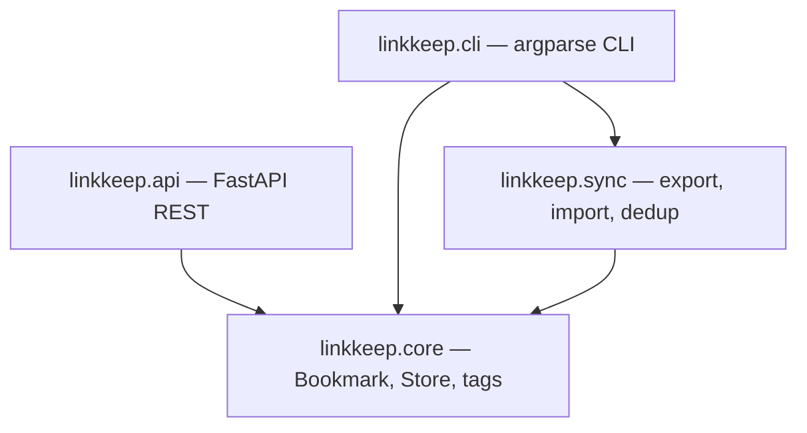

# Architecture

## Overview

linkkeep-svc follows a **layered domain architecture** with four packages, each owning a distinct concern. Three interface domains (api, cli, sync) sit on top of a shared core domain that owns the data model and persistence. The current version is `0.2.0` (declared identically in `linkkeep/__init__.py` and `pyproject.toml`).



The four domains and their import dependencies: core is the shared base; api, cli, and sync depend on core; cli additionally depends on sync for export/import.

## Dependency Rules

The edges above are grounded in actual imports:

1. **core depends on nothing** within the project — only stdlib (`json`, `os`, `pathlib`, `dataclasses`, `datetime`, `collections`, `typing`). `core/models.py`, `core/store.py`, and `core/tags.py` import only from each other and the stdlib.
2. **api** depends on `core` (`routes.py` imports `core.tags.tag_counts`; `deps.py` imports `core.store.Store`) and external `fastapi`/`pydantic`.
3. **cli** depends on `core` and `sync`. `main.py` imports `core.store.Store`; `commands.py` imports `core.models.Bookmark`, `core.store.Store`, `core.tags` (`tag_counts`, `top_tags`, `tag_overlap`), `sync.exporter` (`export_to_json`, `export_to_markdown`), and `sync.importer` (`import_from_json`).
4. **sync** depends on `core` only. `importer.py` imports `core.models.Bookmark`, `core.store.Store`, and `.dedup`; `exporter.py` and `dedup.py` import `core.models.Bookmark`.

This means `sync` does **not** depend on `cli` or `api`, and `api` does **not** depend on `cli` or `sync`. The dependency graph is acyclic.

## Shared Data Model

The `Bookmark` dataclass (`linkkeep/core/models.py`) is the single source of truth for what a bookmark is:

| Field | Type | Default | Notes |
|-------|------|---------|-------|
| `id` | `int` | (required) | Auto-assigned by `Store.next_id()` |
| `url` | `str` | (required) | Normalized for dedup in `sync/dedup.py` |
| `title` | `str` | `""` | Optional human-readable title |
| `tags` | `List[str]` | `[]` | Stored as-is; normalized at statistics time in `core/tags.py` |
| `created_at` | `str` | UTC ISO 8601 now | Set at construction, not updated |

The `to_dict()` / `from_dict()` methods provide JSON serialization (`to_dict` uses `dataclasses.asdict`; `from_dict` tolerates missing `title`, `tags`, and `created_at` keys). The API layer wraps this with Pydantic models (`BookmarkIn`, `BookmarkOut`, `TagCount`, `BookmarkListOut`) for request validation and response shaping — but the canonical data shape lives in core.

`Bookmark` also exposes tag-matching helpers: `matches_tag(tag)` (single-tag filter, used by both CLI `list`/`count` and API `list_bookmarks`), `matches_any_tag(tags)` (OR semantics, reserved for future multi-tag filtering), and `matches_all_tags(tags)` (AND semantics, mirrors the logic in `core.tags.tag_overlap`).

> **Note on tag normalization:** Tags are **not** normalized when stored — `Store.add()` and the API `create_bookmark` endpoint pass tags through unchanged. Normalization (lowercase, strip) is applied at query/statistics time inside `tag_counts`, `tag_overlap`, and related functions. Callers that store mixed-case tags will see them persisted as-is, though tag statistics will collapse case variants.

## Persistence: Store

`Store` (`linkkeep/core/store.py`) is the single persistence abstraction. It:

- Resolves the data directory from `LINKKEEP_HOME` env var (defaults to `~/.linkkeep/`); the JSON file is always `bookmarks.json` under that root.
- Reads/writes `bookmarks.json` as a JSON array of bookmark dicts (UTF-8, `indent=2`, `ensure_ascii=False`).
- Provides `add()`, `remove()`, `load()`, `save()`, `count()`, `next_id()`, `clear()`.
- Lazily creates the parent directory and an empty `[]` file via `_ensure()` if either is missing.

**Every operation is a full load → modify → save cycle.** There is no in-memory caching at the Store level — `add()` loads the full list, appends, and saves; `remove()` loads, filters, and saves; `count()` loads and takes `len()`. This is simple and safe for a single-process tool but means concurrent writers (e.g., CLI and API server simultaneously) could overwrite each other's changes, since each operation reads the file, modifies it, and writes the whole file back without locking.

`next_id(bookmarks)` returns `max(existing ids, default=0) + 1`. `clear()` saves `[]`, resetting the store to empty.

> **Backlog — ID reuse:** Because `next_id` is computed as `max(existing)+1`, removing the bookmark with the highest ID causes that ID to be reused by the next `add()`. For example, with IDs `[1, 2, 3]`, removing #3 then adding a new bookmark yields ID 3 again. If "IDs are never reused" is a desired invariant, `next_id` would need to track a high-water mark rather than recomputing from the current set.

## API Layer: Singleton Store

`linkkeep/api/deps.py` provides `get_store()` as a FastAPI dependency. It lazily initializes a module-level `_store_singleton` on first request, then reuses it for all subsequent requests. This avoids re-parsing `LINKKEEP_HOME` per request but still does a full file read/write per operation (the singleton caches the `Store` object, not the data).

`reset_store_singleton()` clears the singleton, forcing the next `get_store()` call to rebuild the `Store`. It is intended for test isolation so that test cases don't share singleton state.

Tests override `deps._store_singleton` directly with a temp-directory `Store` for isolation; `reset_store_singleton()` is available as a cleaner alternative.

### Route assembly

`linkkeep/api/app.py` creates the `FastAPI` instance (`title="linkkeep-svc"`, `version="0.2.0"`), includes the router from `routes.py`, and exposes a standalone `GET /health` returning `{"status": "ok"}`. The router is mounted under the `/bookmarks` prefix and provides:

- `GET /bookmarks` — list all bookmarks, optional `?tag=` single-tag filter.
- `POST /bookmarks` — create a bookmark (201), returns `BookmarkOut`.
- `DELETE /bookmarks/{id}` — remove by ID (204, or 404 if not found).
- `GET /bookmarks/tags` — tag counts via `core.tags.tag_counts`, sorted by frequency.

There is no update (PUT/PATCH) endpoint. `BookmarkListOut` is defined in `schemas.py` (a wrapper with `total` and `items`) but is not currently used by any route — the list endpoint returns a bare `List[BookmarkOut]`.

## CLI Layer: Subcommand Dispatch

`linkkeep/cli/main.py` builds an `argparse.ArgumentParser` with one subparser per subcommand. Each subparser sets `func` to a handler in `linkkeep/cli/commands.py`. At runtime, `main()` creates a `Store()` instance and calls `args.func(store, args)`. The CLI registers **7 subcommands**:

| Subcommand | Handler | Delegates to |
|------------|---------|--------------|
| `add` | `cmd_add` | `store.add()` |
| `list` | `cmd_list` | `store.load()` + `matches_tag` filter |
| `remove` | `cmd_remove` | `store.remove()` |
| `count` | `cmd_count` | `store.load()` + optional tag filter |
| `export` | `cmd_export` | `sync.exporter` (json or markdown) |
| `import` | `cmd_import` | `sync.importer.import_from_json` |
| `tag-overlap` | `cmd_tag_overlap` | `core.tags.tag_overlap` |

The `export` and `import` subcommands are the cli→sync dependency edge: `commands.py` imports `sync.exporter` and `sync.importer` directly.

> **Backlog — unwired handler:** `cmd_top_tags` is defined in `commands.py` (prints top-N tags via `core.tags.top_tags`) but no `top-tags` subparser is registered in `main.py`, so it is currently unreachable from the CLI. Wiring it would require adding a subparser with an `--n` argument and `set_defaults(func=c.cmd_top_tags)`.

## Sync Layer: Export / Import / Dedup

- **Export** (`sync/exporter.py`): `export_to_json` writes bookmarks to a JSON array in the same format as Store's internal file (round-trippable by the importer). `export_to_markdown` groups bookmarks by tag, sorts tags alphabetically, and places untagged bookmarks under a `(无标签)` section. `count_by_tag` provides a pre-export distribution preview (untagged counted under `_untagged`).
- **Import** (`sync/importer.py`): `import_from_json` reads a JSON file, validates each item has a `url` field (raises `ValueError` otherwise), deduplicates incoming bookmarks against existing Store bookmarks by normalized URL, reassigns IDs sequentially starting from `store.next_id(existing)`, and saves the merged list (`existing + fresh`). Returns the count of newly added bookmarks.
- **Dedup** (`sync/dedup.py`): `normalize_url()` strips trailing slashes and lowercases the entire string. `dedup_by_url()` returns only incoming bookmarks whose normalized URL is not already in the existing set **and** not already seen earlier in the same incoming batch (existing wins, no overwrite; within-batch duplicates are also dropped). `dedup_stats()` provides a pre-import preview (`incoming`, `fresh`, `dropped` counts).

## Package Structure

```
linkkeep/
├── __init__.py          # Package docstring, __version__ = "0.2.0"
├── core/
│   ├── __init__.py
│   ├── models.py        # Bookmark dataclass: to_dict, from_dict, matches_tag,
│   │                    #   matches_any_tag, matches_all_tags
│   ├── store.py         # Store: JSON persistence, CRUD, ID allocation, clear
│   └── tags.py          # normalize_tag, normalize_tags, tag_counts, top_tags,
│                        #   rarest_tags, tag_overlap
├── api/
│   ├── __init__.py
│   ├── app.py           # FastAPI app assembly + /health
│   ├── deps.py          # get_store() singleton, reset_store_singleton()
│   ├── routes.py        # /bookmarks list, create, delete + /bookmarks/tags
│   └── schemas.py       # BookmarkIn, BookmarkOut, TagCount, BookmarkListOut
├── cli/
│   ├── __init__.py
│   ├── commands.py      # cmd_add, cmd_list, cmd_remove, cmd_count,
│   │                    #   cmd_export, cmd_import, cmd_tag_overlap,
│   │                    #   cmd_top_tags (defined, not wired)
│   └── main.py          # argparse parser + main() entry point (7 subcommands)
└── sync/
    ├── __init__.py
    ├── dedup.py          # normalize_url, dedup_by_url, dedup_stats
    ├── exporter.py       # export_to_json, export_to_markdown, count_by_tag
    └── importer.py       # import_from_json
```

## Focused Tests

The test suite (`tests/`) is organized one file per domain, each using a temp-directory `Store` for isolation:

- **`tests/test_core.py`** — `Bookmark.to_dict`/`from_dict` round-trip; `Store.add`/`load`/`next_id`/`remove` lifecycle; `normalize_tag` case/whitespace folding; `tag_counts` collapsing mixed-case tags; `tag_overlap` AND semantics and case-insensitivity.
- **`tests/test_api.py`** — FastAPI `TestClient` against the real app with `deps._store_singleton` overridden to a temp `Store`; covers `/health`, create+list round-trip (verifying ID starts at 1), delete 404, and `/bookmarks/tags` counts.
- **`tests/test_sync.py`** — `normalize_url` slash/case folding; `dedup_by_url` skipping existing URLs; JSON export round-trip; Markdown grouping (tag sections + `(无标签)`); `import_from_json` dedup-and-merge (existing URL skipped, new URL added with reassigned ID).
