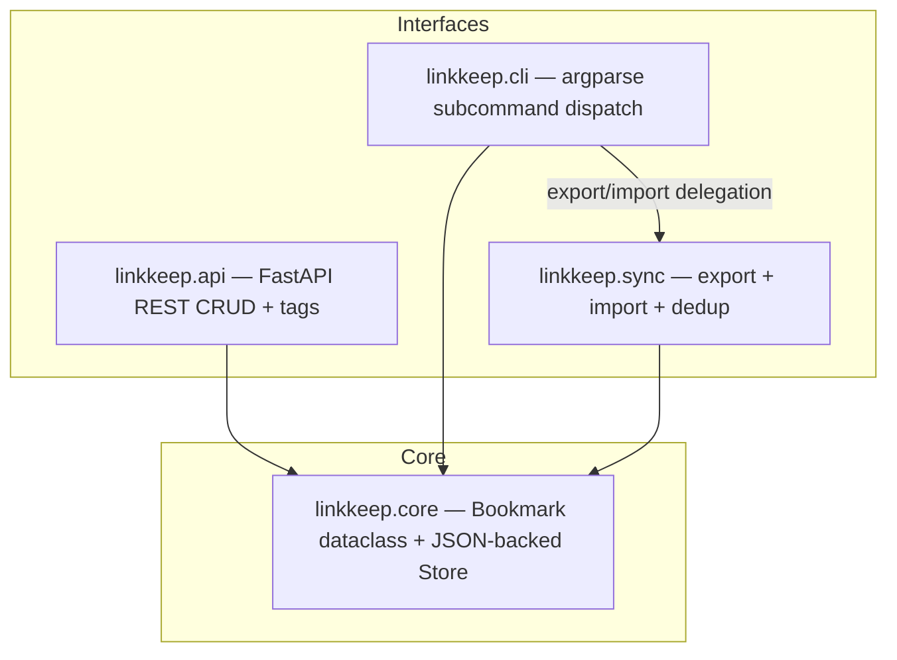

# Architecture

## Overview

linkkeep-svc follows a **layered domain architecture** with four packages, each owning a distinct concern. Three interface domains — `api`, `cli`, and `sync` — sit on top of a shared **core** domain that owns the data model and persistence. All three interfaces reach the data file only through the same core `Store` and `Bookmark` types, so core is the single foundation every other layer builds on.



The layering: `api`, `cli`, and `sync` all depend downward on `core`; `cli` additionally depends on `sync` so its `export`/`import` subcommands can delegate to `sync.exporter` and `sync.importer`. The graph contains no back edges.

## Dependency Rules

1. **core depends on nothing** within the project — only the standard library (`json`, `os`, `pathlib`, `dataclasses`, `datetime`, `collections`).
2. **api** depends on `core` (Store, tags) and the external `fastapi`/`pydantic`.
3. **cli** depends on `core` (Store, tags, models) and on `sync` (exporter, importer) for the export/import subcommands.
4. **sync** depends on `core` only (Bookmark, Store).

Consequently the graph is **acyclic**: `sync` does not import `cli` or `api`, and `api` does not import `cli` or `sync`. This keeps the persistence and data-model decisions localized to `core` while leaving each interface free to choose its own protocol (HTTP, argparse, file I/O).

## Shared Data Model

The `Bookmark` dataclass (`linkkeep/core/models.py`) is the single source of truth for what a bookmark is:

| Field | Type | Default | Notes |
|-------|------|---------|-------|
| `id` | `int` | (required) | Auto-assigned by `Store.next_id()` |
| `url` | `str` | (required) | Normalized for dedup in `sync/dedup.py` |
| `title` | `str` | `""` | Optional human-readable title |
| `tags` | `List[str]` | `[]` | Normalized (lowercase, stripped) in `core/tags.py` |
| `created_at` | `str` | UTC ISO 8601 now | Set at construction, not updated |

`to_dict()` serializes via `dataclasses.asdict()` and `from_dict(data)` reconstructs a `Bookmark`, giving `id` and `url` required status (missing keys raise `KeyError`) while `title`/`tags`/`created_at` fall back to safe defaults. These two methods are the JSON serialization boundary shared by `Store`, the sync exporter, and the importer.

The API layer wraps this canonical shape in Pydantic schemas — `BookmarkIn` (request body), `BookmarkOut` (response), and `TagCount` (tag stats) — for request validation and response shaping, but the authoritative data definition stays in core, which remains framework-free. **Invariant: because all three interface domains share the same core `Bookmark` and `Store`, any change to the data model ripples across every domain.** A new field on `Bookmark` must be reflected in `from_dict`/`to_dict`, in the API's Pydantic schemas, and in the sync import/export format.

## Persistence: Store

`Store` (`linkkeep/core/store.py`) is the single persistence abstraction. It:

- Resolves the data directory from the `LINKKEEP_HOME` environment variable (defaults to `~/.linkkeep/`) and reads/writes `bookmarks.json` as a JSON array of bookmark dicts.
- Provides `load()`, `save()`, `add()`, `remove()`, `count()`, `next_id()`, and `clear()`.
- Lazily creates the parent directory and an empty `[]` file (via `_ensure()`) if either is missing.

**Every mutating operation is a full load → modify → save cycle with no in-memory caching.** `add()` loads all bookmarks, appends one, and writes the whole list back; `remove()` loads, filters, and writes back. This is simple and correct for a single-process tool, but it means **concurrent writers can overwrite each other's changes**: if the CLI and the API server (or two CLI invocations) run simultaneously, each save clobbers the file with its own view of the data and there is no locking or read-modify-write atomicity to prevent lost updates.

ID allocation follows `next_id(bookmarks) = max(existing ids) + 1` (or `1` when the list is empty). Deleted IDs are not reused, and after a full delete the counter continues from the historical max. `clear()` writes `[]`, which resets the counter to `1` on the next `add()`.

## API Layer: Singleton Store

`linkkeep/api/deps.py` provides `get_store()` as a FastAPI dependency. It lazily initializes a module-level `_store_singleton` on the first request, then reuses that same `Store` instance for all subsequent requests. This avoids re-parsing `LINKKEEP_HOME` per request, but note that each operation still performs a full file read/write through the Store.

`reset_store_singleton()` sets `_store_singleton` back to `None`, forcing the next `get_store()` call to rebuild the `Store`. It exists for test isolation so that test cases do not share singleton state. In practice, tests currently override `deps._store_singleton` directly with a temp-directory `Store`; `reset_store_singleton()` is available as the cleaner, intended alternative.

The singleton is a process-wide cache of the `Store` *object* (its resolved path), not of the bookmark data — the load→modify→save cycle still runs against the JSON file on every request.

## CLI Layer: Subcommand Dispatch

`linkkeep/cli/main.py` builds an `argparse.ArgumentParser` with one subparser per subcommand in `build_parser()`. Each subparser calls `set_defaults(func=handler)` to bind a handler from `linkkeep/cli/commands.py`. At runtime, `main()` parses the arguments, creates a **single** `Store()` instance, and invokes `args.func(store, args)` — so every handler receives the same store reference.

The CLI's `export` and `import` subcommands do not implement their own file logic. `cmd_export` delegates to `sync.exporter.export_to_json` / `export_to_markdown`, and `cmd_import` delegates to `sync.importer.import_from_json`. This is the reason the `cli → sync` dependency edge exists: the CLI is the front door, `sync` owns the cross-device serialization logic, and both rely on `core`.

## Sync Layer: Export / Import / Dedup

The sync domain handles cross-device bookmark synchronization and sits beside `api` and `cli` as a third interface to `core`. It depends on `core` only and never imports `cli` or `api`, even though the CLI calls into it.

- **Export** (`sync/exporter.py`): Writes bookmarks to JSON (the same array format the Store writes internally, so the importer can read it straight back) or to grouped Markdown. The Markdown exporter groups bookmarks under `## <tag>` headings sorted alphabetically, places untagged bookmarks under a `## (无标签)` section, and uses the bookmark's `title` (falling back to the URL) as the link text.
- **Import** (`sync/importer.py`): `import_from_json(store, in_path)` reads a JSON file, validates that every item has a `url` field (raising `ValueError` otherwise), converts each item to a `Bookmark` via `Bookmark.from_dict()`, then loads the existing bookmarks from the `Store` and calls `dedup_by_url()` to find the fresh ones. Fresh bookmarks get **reassigned sequential IDs** starting from `store.next_id(existing)` (their original imported IDs are discarded), and the merged `existing + fresh` list is saved back through the Store. The function returns the count of newly added bookmarks.
- **Dedup** (`sync/dedup.py`): `normalize_url()` strips whitespace and trailing slashes and lowercases the whole URL. `dedup_by_url(existing, incoming)` returns only incoming bookmarks whose normalized URL is not already present — an **"existing wins"** strategy that silently drops duplicates rather than overwriting or merging fields. It also deduplicates within the incoming batch itself. `dedup_stats()` provides a pre-import preview of how many items are fresh vs. dropped.

## Package Structure

```
linkkeep/
├── __init__.py          # Package docstring, __version__ = "0.2.0"
├── core/
│   ├── __init__.py
│   ├── models.py        # Bookmark dataclass
│   ├── store.py         # Store: JSON persistence, CRUD, ID allocation
│   └── tags.py          # normalize_tag, normalize_tags, tag_counts, top_tags, rarest_tags, tag_overlap
├── api/
│   ├── __init__.py
│   ├── app.py           # FastAPI app assembly + /health
│   ├── deps.py          # get_store() singleton, reset_store_singleton()
│   ├── routes.py        # /bookmarks CRUD + /bookmarks/tags
│   └── schemas.py       # BookmarkIn, BookmarkOut, TagCount, BookmarkListOut
├── cli/
│   ├── __init__.py
│   ├── commands.py      # cmd_add, cmd_list, cmd_remove, cmd_count,
│   │                    #   cmd_export, cmd_import, cmd_top_tags, cmd_tag_overlap
│   └── main.py          # argparse parser + main() entry point
└── sync/
    ├── __init__.py
    ├── dedup.py          # normalize_url, dedup_by_url, dedup_stats
    ├── exporter.py       # export_to_json, export_to_markdown, count_by_tag
    └── importer.py       # import_from_json
```

For per-domain detail on individual types, functions, and business rules, see the [Domain Guide](domain-guide.md).
