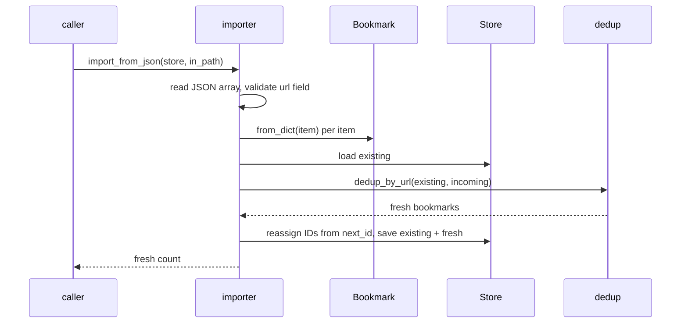

# Domain Guide

This page is a per-domain reference for the key types, functions, business rules, and non-obvious behaviors in linkkeep-svc. Use it to quickly find where a behavior lives and why. For the cross-domain dependency graph and design rationale, see [architecture.md](architecture.md); for install and usage, see [quickstart.md](quickstart.md).

---

## Core Domain (`linkkeep/core/`)

The data foundation shared by all other domains. No dependencies on api, cli, or sync — only the stdlib.

### `models.py` — Bookmark Dataclass

```python
@dataclass
class Bookmark:
    id: int
    url: str
    title: str = ""
    tags: List[str] = field(default_factory=list)
    created_at: str = field(default_factory=lambda: datetime.now(timezone.utc).isoformat())
```

- **`to_dict()`**: Serializes to a plain dict via `dataclasses.asdict()`.
- **`from_dict(data)`**: Reconstructs from a dict. Missing `title`/`tags`/`created_at` get safe defaults; `id` and `url` are **required** (raises `KeyError` if absent).
- **`matches_tag(tag)`**: Returns `True` if `tag` is in `self.tags`. This is a **case-sensitive** check — the method itself does **not** normalize. Both the CLI (`list`/`count --tag`) and API (`GET /bookmarks?tag=`) call this directly, so a query `?tag=Ref` will not match a stored `ref`. See the backlog note below.
- **`matches_any_tag(tags)`**: Returns `True` if any tag in the provided list is in `self.tags` (OR semantics). Case-sensitive, like `matches_tag`. Not yet called by CLI or API.
- **`matches_all_tags(tags)`**: Returns `True` only if every tag in the provided list is in `self.tags` (AND semantics, complementing `matches_any_tag`). Case-sensitive. Not yet called by CLI or API; `core.tags.tag_overlap` is the case-insensitive equivalent that the CLI actually uses.

### `store.py` — JSON File Persistence

| Method | Behavior |
|--------|----------|
| `Store(path=None)` | Resolves path from `LINKKEEP_HOME` env or `~/.linkkeep/bookmarks.json` |
| `_ensure()` | Creates parent dir + empty `[]` file if missing |
| `load()` | Reads JSON array, returns `List[Bookmark]` |
| `save(bookmarks)` | Writes `List[Bookmark]` as JSON (indent=2, ensure_ascii=False) |
| `next_id(bookmarks)` | `max(b.id for b in bookmarks, default=0) + 1` |
| `add(url, title="", tags=None)` | Loads, creates `Bookmark` with next ID, appends, saves, returns it (`tags or []`) |
| `remove(bookmark_id)` | Loads, filters out by ID, saves. Returns `False` if ID not found |
| `count()` | `len(self.load())` — convenience wrapper |
| `clear()` | Saves an empty list `[]` to the JSON file. Dangerous operation intended for test/reset scenarios. |

**Business rule — ID allocation**: IDs are assigned as `max(current existing IDs, default=0) + 1`, recomputed from the **current** set on every `add()` — there is no high-water mark. Consequently, if the bookmark with the highest ID is deleted, that ID is **reused** by the next `add()` (e.g. with IDs `[1, 2, 3]`, removing #3 then adding yields ID 3 again). `clear()` is the only way to reset: it saves `[]`, so the next `add()` starts again at ID 1.

### `tags.py` — Tag Normalization & Statistics

| Function | Behavior |
|----------|----------|
| `normalize_tag(tag)` | `tag.strip().lower()` — eliminates case/whitespace variants |
| `normalize_tags(tags)` | Normalizes each, drops empties, deduplicates, preserves first-seen order |
| `tag_counts(bookmarks)` | Returns `Counter` of normalized tags across all bookmarks' tag lists |
| `top_tags(counts, n=5)` | Returns `counts.most_common(n)` — top N `(tag, count)` pairs |
| `rarest_tags(counts, n=5)` | Returns the N least-common `(tag, count)` pairs (reversed ascending); empty list if `counts` is empty. Not exposed via CLI or API. |
| `tag_overlap(bookmarks, tag_a, tag_b)` | Counts bookmarks that have **both** `tag_a` and `tag_b` (AND semantics). Both arguments and each bookmark's tags are normalized (case-insensitive) before comparison. Powers the CLI `tag-overlap` subcommand. |

**Business rule — tag normalization gap**: Tags are normalized to lowercase + stripped inside `tag_counts()`, `top_tags()`, `rarest_tags()`, and `tag_overlap()`. However, normalization is **not** applied when a bookmark is added via `Store.add()` or the API `create_bookmark` endpoint — tags are stored verbatim in the JSON file. This means stored data may contain mixed-case tags (`"Ref"` and `"ref"` persisted as distinct entries) even though statistics collapse them. The single-tag query path (`matches_tag`) is likewise un-normalized, so `list --tag ref` will miss a bookmark stored with `"Ref"`.

---

## API Domain (`linkkeep/api/`)

FastAPI REST layer. Exposes core Store operations over HTTP.

### `app.py` — Application Assembly

- Creates `FastAPI(title="linkkeep-svc", version="0.2.0")`.
- Includes the router from `routes.py` (mounted under `/bookmarks`).
- Adds a standalone `GET /health` endpoint returning `{"status": "ok"}`.

### `deps.py` — Dependency Injection

- `get_store()` returns a module-level singleton `_store_singleton`.
- First call creates `Store()` (resolving `LINKKEEP_HOME` at that point); subsequent calls return the same instance. The singleton caches the `Store` object, **not** the data — every request still does a full file read/write.
- `reset_store_singleton()` sets `_store_singleton` back to `None`, forcing the next `get_store()` to rebuild the `Store`. Intended for test isolation.
- Tests currently override `deps._store_singleton` directly with a temp-directory `Store`; `reset_store_singleton()` is available as a cleaner alternative.

### `schemas.py` — Pydantic Models

| Model | Purpose | Fields |
|-------|---------|--------|
| `BookmarkIn` | POST request body | `url: str`, `title: str = ""`, `tags: List[str] = []` |
| `BookmarkOut` | Response shape | `id`, `url`, `title`, `tags`, `created_at` |
| `TagCount` | Tag stats response | `tag: str`, `count: int` |
| `BookmarkListOut` | List wrapper (unused) | `total: int`, `items: List[BookmarkOut]` |

`BookmarkListOut` is defined but not used by any route; `GET /bookmarks` returns `List[BookmarkOut]` directly.

### `routes.py` — REST Endpoints

All routes are prefixed with `/bookmarks`.

| Method | Path | Handler | Behavior |
|--------|------|---------|----------|
| GET | `/bookmarks` | `list_bookmarks` | Optional `?tag=` filter via `Bookmark.matches_tag()` (case-sensitive) |
| POST | `/bookmarks` | `create_bookmark` | Calls `store.add()`, returns **201** with `BookmarkOut` |
| DELETE | `/bookmarks/{bookmark_id}` | `delete_bookmark` | Returns **204** on success, **404** if ID not found |
| GET | `/bookmarks/tags` | `list_tag_counts` | Returns `List[TagCount]` sorted by count desc via `Counter.most_common()` |

The `?tag=` filter uses `matches_tag`, which is case-sensitive: `?tag=Ref` will not match a bookmark stored with `ref`. There is no update (PUT/PATCH) endpoint.

---

## CLI Domain (`linkkeep/cli/`)

Argparse-based command-line interface. Entry point registered as `linkkeep = "linkkeep.cli.main:main"` in `pyproject.toml`.

### `main.py` — Parser & Entry Point

- `build_parser()` creates one subparser per subcommand, each with `set_defaults(func=handler)`.
- `main(argv=None)` parses args, creates a fresh `Store()`, calls `args.func(store, args)`.
- **7 subparsers are registered**: `add`, `list`, `remove`, `count`, `export`, `import`, `tag-overlap`.

### `commands.py` — Subcommand Handlers

| Handler | Subcommand | Behavior |
|---------|------------|----------|
| `cmd_add` | `add <url> [--title] [--tag ...]` | Creates bookmark, prints `added #N: <url>` |
| `cmd_list` | `list [--tag]` | Prints `#id  url  [title]  (tag,tag)` per line (case-sensitive tag filter) |
| `cmd_remove` | `remove <id>` | Deletes by ID, prints confirmation or error |
| `cmd_count` | `count [--tag]` | Prints integer count, optionally filtered by tag (case-sensitive) |
| `cmd_export` | `export --format <json\|markdown> --out <path>` | Delegates to `sync.exporter` |
| `cmd_import` | `import <file>` | Delegates to `sync.importer`, prints `imported N new bookmarks (duplicates skipped)` |
| `cmd_tag_overlap` | `tag-overlap <tag_a> <tag_b>` | Prints count of bookmarks having both tags (AND, case-insensitive) |
| `cmd_top_tags` | *(not wired)* | Defined: prints `tag\tcount` for top N tags via `top_tags(tag_counts(...))`. No `top-tags` subparser exists in `main.py`, so it is unreachable from the CLI. |

`README.md` documents only 6 subcommands (`add / list / remove / count / export / import`); it does not mention `tag-overlap`, and `top-tags` is not wired at all.

---

## Sync Domain (`linkkeep/sync/`)

Export, import, and deduplication for cross-device bookmark synchronization. Depends on core only.

### `dedup.py` — URL-Based Deduplication

| Function | Behavior |
|----------|----------|
| `normalize_url(url)` | Strips whitespace, removes a single trailing `/`, lowercases the **entire** URL (scheme, host, path, query) |
| `dedup_by_url(existing, incoming)` | Returns only incoming bookmarks whose normalized URL is not in existing **and** not already seen earlier in the incoming batch. Existing wins — no overwrite. |
| `dedup_stats(existing, incoming)` | Returns `{"incoming": N, "fresh": M, "dropped": N-M}` for pre-import preview |

**Business rule — dedup strategy (existing wins)**: When the same normalized URL exists in both existing and incoming data, the **existing** bookmark is kept and the incoming one is **silently dropped** — there is no merge of fields like title or tags. This is "existing wins", not "last write wins". Within-batch duplicates in `incoming` are also collapsed (first occurrence wins).

**Note on `normalize_url`**: It lowercases the entire URL including path and query. So `https://Example.com/Path` and `https://example.com/Path` are duplicates, but `https://example.com/path` and `https://example.com/Path` are **not** (path case differs). Only one trailing slash is stripped. It does not handle URL-encoded characters, default ports, or www-prefix differences.

### `exporter.py` — Export

| Function | Behavior |
|----------|----------|
| `count_by_tag(bookmarks)` | Returns `Dict[str, int]`; untagged bookmarks counted under `"_untagged"`. Does **not** normalize tags. |
| `export_to_json(bookmarks, out_path)` | Writes JSON array (same format as Store's internal file, round-trippable by the importer). Creates parent dirs. |
| `export_to_markdown(bookmarks, out_path)` | Writes grouped Markdown: `## <tag>` sections sorted alphabetically, untagged under `## (无标签)` |

**Divergence — `count_by_tag` vs `tag_counts`**: Both count tags per bookmark but differ. `exporter.count_by_tag` groups untagged bookmarks into `"_untagged"` and does **not** normalize tags (mixed-case tags stay distinct). `core.tags.tag_counts` normalizes tags and ignores untagged bookmarks entirely. `count_by_tag` is itself not called by any export function, CLI, or API.

### `importer.py` — Import & Merge

`import_from_json(store, in_path) -> int`:

1. Reads JSON array from `in_path`.
2. Validates every item has a `url` field (raises `ValueError` if missing).
3. Converts each item to `Bookmark` via `Bookmark.from_dict()` (incoming `id` is read but later discarded).
4. Loads existing bookmarks from `store`.
5. Calls `dedup_by_url(existing, incoming)` to find fresh (non-duplicate) bookmarks; returns `0` early if none.
6. Reassigns IDs: starting at `store.next_id(existing)`, assigns `next_id + i` to the i-th fresh bookmark.
7. Saves `existing + fresh` as the merged list.
8. Returns the count of newly added bookmarks.



*Import merge flow: read and validate JSON, build Bookmarks, dedup against existing by normalized URL (existing wins), reassign sequential IDs continuing from the existing max, save the merged list, and return the fresh count.*

**Business rule — ID reassignment on import**: Incoming bookmarks' original IDs are discarded. Fresh bookmarks get new sequential IDs continuing from `store.next_id(existing)` (the current existing max + 1). This prevents ID collisions when merging data from another device, but it means the same imported bookmark receives a different ID on each device it is merged into.

---

## Backlog of Unused / Divergent Surfaces

Source-grounded list of surfaces that exist but are not reachable from a user-facing path, or that diverge from their apparent counterparts:

- **`BookmarkListOut` (api/schemas.py)** — defined but unused; `GET /bookmarks` returns `List[BookmarkOut]` directly.
- **`cmd_top_tags` (cli/commands.py)** — handler defined but no `top-tags` subparser registered in `main.py`; unreachable from the CLI. Wiring it would require adding a subparser with an `--n` argument and `set_defaults(func=c.cmd_top_tags)`.
- **`rarest_tags` (core/tags.py)** — defined but not imported by CLI or API.
- **`dedup_stats` (sync/dedup.py)** — pre-import preview helper, not exposed via any CLI subcommand or API route.
- **`count_by_tag` (sync/exporter.py)** — defined but not called by any export function, CLI, or API; diverges from `core.tags.tag_counts` (groups untagged under `_untagged`, no normalization).
- **`matches_any_tag` / `matches_all_tags` (core/models.py)** — defined on `Bookmark` but not called by CLI or API; `tag_overlap` is the case-insensitive AND path actually used.
- **README gap** — `README.md` documents 6 subcommands and omits `tag-overlap` (which is wired and working); `top-tags` is not documented because it is not wired.
