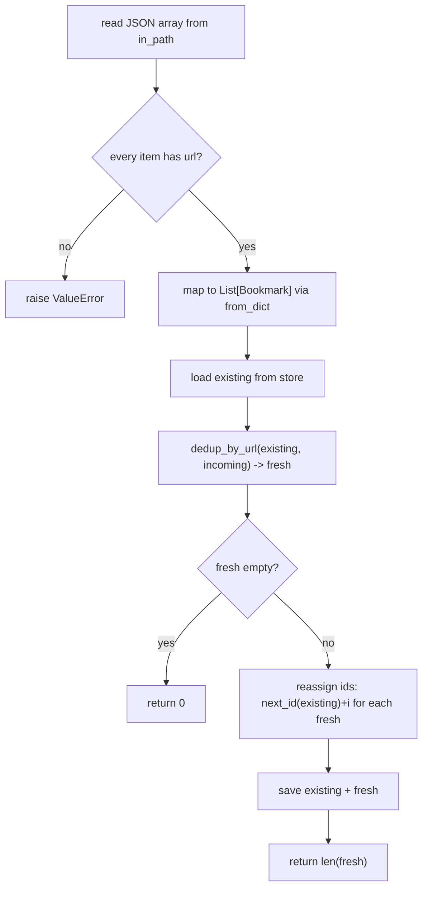

# Domain Guide

This page is a per-domain reference for the key types, functions, endpoints, and business rules in linkkeep-svc. Use it to quickly find where a behavior lives and why — including the non-obvious rules around ID allocation, tag normalization timing, case-sensitive vs case-insensitive tag matching, URL normalization limits, and the existing-wins dedup strategy.

The service is split into four domains that all read and write the same JSON file through one shared `Store`:

- **core** (`linkkeep/core/`) — the data foundation: `Bookmark` model, `Store` persistence, tag statistics. No dependencies on api, cli, or sync.
- **api** (`linkkeep/api/`) — FastAPI REST layer over the core `Store`.
- **cli** (`linkkeep/cli/`) — argparse entry point driving `Store` and `sync`.
- **sync** (`linkkeep/sync/`) — export, import, and URL-based dedup for cross-device synchronization.

See [Architecture](architecture.md) for the cross-domain overview and [Quickstart](quickstart.md) for usage.

---

## Core Domain (`linkkeep/core/`)

### `models.py` — Bookmark Dataclass

```python
@dataclass
class Bookmark:
    id: int
    url: str
    title: str = ""
    tags: List[str] = field(default_factory=list)
    created_at: str = field(default_factory=lambda: datetime.now(timezone.utc).isoformat())
```

- **`to_dict()`**: Serializes to a plain dict via `dataclasses.asdict()`.
- **`from_dict(data)`**: Reconstructs from a dict. `id` and `url` are required (raises `KeyError` if absent); `title`/`tags`/`created_at` fall back to safe defaults (`""`, `[]`, and a fresh UTC ISO timestamp respectively).
- **`matches_tag(tag)`**: Returns `True` if `tag` is in `self.tags`. This is a **case-sensitive** check — the method performs no normalization. Callers (CLI `list --tag`, API `?tag=`) pass the raw query value straight through, so a stored `"ref"` will not match a query `"Ref"`.
- **`matches_any_tag(tags)`**: OR semantics — `True` if any provided tag is in `self.tags`. Also case-sensitive. Added for future multi-tag filtering; not currently called by CLI or API.
- **`matches_all_tags(tags)`**: AND semantics — `True` only if every provided tag is in `self.tags`. Also case-sensitive. Added as a sentinel/idempotency helper for cross-run re-verification (km-9); not yet called by CLI or API.

### `store.py` — JSON File Persistence

The single data backbone shared by api, cli, and sync. All three domains read/write the same `bookmarks.json` through this class.

| Method | Behavior |
|--------|----------|
| `Store(path=None)` | `path` defaults to `_home() / "bookmarks.json"`, where `_home()` reads `LINKKEEP_HOME` env or `~/.linkkeep`. |
| `_ensure()` | Creates parent dir and writes an empty `[]` file if missing. |
| `load()` | Calls `_ensure()`, reads the JSON array, returns `List[Bookmark]` via `Bookmark.from_dict`. |
| `save(bookmarks)` | Calls `_ensure()`, writes `[b.to_dict() ...]` as JSON with `ensure_ascii=False, indent=2`. |
| `next_id(bookmarks)` | `max(b.id for b in bookmarks, default=0) + 1` — so `1` for an empty list. |
| `add(url, title="", tags=None)` | Loads, creates a `Bookmark` with `next_id`, appends, saves, returns it. `tags` defaults to `[]` when `None`. |
| `remove(bookmark_id)` | Loads, filters out by ID, saves. Returns `False` if the ID was not present (no save occurs). |
| `count()` | `len(self.load())` — convenience wrapper. |
| `clear()` | Saves `[]` to the file, removing all bookmarks. Dangerous; intended for test/reset scenarios. |

**Business rule — ID allocation**: IDs are `max(existing_ids) + 1`. After deletes, IDs never reset — new adds continue from the historical max, and deleted IDs are not reused. The only way to reset the counter to 1 is `clear()`, which saves an empty list so the next `add()` starts at 1 again.

### `tags.py` — Tag Normalization & Statistics

| Function | Behavior |
|----------|----------|
| `normalize_tag(tag)` | `tag.strip().lower()` — collapses case and whitespace variants. |
| `normalize_tags(tags)` | Normalizes each tag, deduplicates, preserves first-seen order; empty normalized results are dropped. |
| `tag_counts(bookmarks)` | Returns a `Counter` of **normalized** tags across every bookmark's tag list. Untagged bookmarks contribute nothing. |
| `top_tags(counts, n=5)` | `counts.most_common(n)` — top N `(tag, count)` pairs. |
| `rarest_tags(counts, n=5)` | The N least-common `(tag, count)` pairs (`counts.most_common()[-n:][::-1]`, empty if `counts` is empty). Useful for spotting orphaned or misspelled tags. Not exposed via CLI or API. |
| `tag_overlap(bookmarks, tag_a, tag_b)` | Counts bookmarks whose normalized tag set contains **both** `tag_a` and `tag_b` (AND semantics, case-insensitive). Powers the CLI `tag-overlap` subcommand. |

**Business rule — tag normalization timing**: `normalize_tag` is applied inside `tag_counts`/`top_tags`/`tag_overlap`, but **not** inside `Store.add`. Tags are stored as-is in the JSON file, so the persisted format may contain un-normalized tags (e.g. `"Ref"`). Normalization happens only at count/filter/statistics time. Note that the CLI `list --tag` and API `?tag=` filters call the case-sensitive `Bookmark.matches_tag` directly, so they do **not** normalize the query and may miss differently-cased stored tags.

---

## API Domain (`linkkeep/api/`)

FastAPI REST layer. Exposes core `Store` operations over HTTP.

### `app.py` — Application Assembly

- Creates `FastAPI(title="linkkeep-svc", version="0.2.0")` and includes the router from `routes.py`.
- Adds a `/health` endpoint returning `{"status": "ok"}`.
- Run with `uvicorn linkkeep.api.app:app`.

### `deps.py` — Dependency Injection

- `get_store()` returns a module-level singleton `_store_singleton`. The first call constructs `Store()` (resolving `LINKKEEP_HOME` at that point); subsequent calls return the same instance.
- `reset_store_singleton()` sets `_store_singleton` back to `None`, forcing the next `get_store()` to rebuild the `Store`. Intended for test isolation so cases don't share singleton state.

### `schemas.py` — Pydantic Models

| Model | Purpose | Fields |
|-------|---------|--------|
| `BookmarkIn` | POST request body | `url: str`, `title: str = ""`, `tags: List[str] = Field(default_factory=list)` |
| `BookmarkOut` | Response shape | `id`, `url`, `title`, `tags`, `created_at` |
| `TagCount` | Tag stats response | `tag: str`, `count: int` |
| `BookmarkListOut` | List wrapper (unused) | `total: int`, `items: List[BookmarkOut]` |

`BookmarkListOut` is defined but unused — `GET /bookmarks` returns `List[BookmarkOut]` directly.

### `routes.py` — REST Endpoints

All routes are prefixed with `/bookmarks`.

| Method | Path | Handler | Behavior |
|--------|------|---------|----------|
| GET | `/bookmarks` | `list_bookmarks` | Optional `?tag=` filter via `Bookmark.matches_tag()` (case-sensitive). Returns `List[BookmarkOut]`. |
| POST | `/bookmarks` | `create_bookmark` | Calls `store.add(url, title, tags)`, returns `201` with `BookmarkOut`. |
| DELETE | `/bookmarks/{id}` | `delete_bookmark` | Calls `store.remove(id)`; returns `204` on success, `404` if the ID is not found. |
| GET | `/bookmarks/tags` | `list_tag_counts` | Returns `List[TagCount]` from `tag_counts(store.load()).most_common()` — sorted by count descending. |

**Caveat — case-sensitive tag filter**: `GET /bookmarks?tag=` passes the raw query to `Bookmark.matches_tag`, which is case-sensitive and un-normalized. A client passing `?tag=Ref` will not match bookmarks stored with `ref`.

---

## CLI Domain (`linkkeep/cli/`)

Argparse-based command-line interface. Entry point registered as `linkkeep = "linkkeep.cli.main:main"` in `pyproject.toml`.

### `main.py` — Parser & Entry Point

- `build_parser()` creates subparsers; each calls `set_defaults(func=handler)` so the chosen handler is dispatched via `args.func`.
- `main(argv=None)` parses args, constructs `Store()`, and calls `args.func(store, args)`.
- Subparsers actually registered: `add`, `list`, `remove`, `count`, `export`, `import`, `tag-overlap`.

### `commands.py` — Subcommand Handlers

| Handler | Subcommand (if wired) | Behavior |
|---------|------------------------|----------|
| `cmd_add` | `add <url> [--title] [--tag ...]` | Creates bookmark, prints `added #N: <url>`. |
| `cmd_list` | `list [--tag]` | Prints `#id  url  [title]  (tag,tag)` per line, or `(no bookmarks)`. Filters via case-sensitive `matches_tag`. |
| `cmd_remove` | `remove <id>` | Deletes by ID; prints `removed #N` or `no bookmark with id N`. |
| `cmd_count` | `count [--tag]` | Prints integer count, optionally filtered by tag (case-sensitive). |
| `cmd_export` | `export --format <json\|markdown> --out <path>` | Delegates to `sync.exporter`; prints `exported N bookmarks -> <path>`. |
| `cmd_import` | `import <file>` | Delegates to `sync.importer`; prints `imported N new bookmarks (duplicates skipped)`. |
| `cmd_tag_overlap` | `tag-overlap <tag_a> <tag_b>` | Prints `<a> & <b>: <count>` (AND, case-insensitive via `tag_overlap`). |
| `cmd_top_tags` | **not wired** | Handler exists (prints `tag\tcount` for top N via `top_tags`/`tag_counts`), but `build_parser` registers no `top-tags` subparser, so it is unreachable from the CLI entry point. |

**README gap**: `README.md` documents only the original six subcommands (`add / list / remove / count / export / import`) and omits `tag-overlap` (which is wired) entirely. `top-tags` is neither wired nor documented.

---

## Sync Domain (`linkkeep/sync/`)

Export, import, and deduplication for cross-device bookmark synchronization.

### `dedup.py` — URL-Based Deduplication

| Function | Behavior |
|----------|----------|
| `normalize_url(url)` | Strips whitespace, drops a single trailing `/`, lowercases the entire URL (scheme, host, path, and query). |
| `dedup_by_url(existing, incoming)` | Returns only incoming bookmarks whose normalized URL is not in `existing` and not already seen in the incoming batch. Existing wins; duplicates are silently dropped (no field merge). |
| `dedup_stats(existing, incoming)` | Returns `{"incoming": N, "fresh": M, "dropped": N-M}` — a pre-import preview. Not exposed via CLI or API. |

**Business rule — existing-wins dedup**: When the same normalized URL appears in both existing and incoming data, the existing bookmark is kept and the incoming one is silently dropped — no merging of title or tags. This is "existing wins," not "last write wins." `dedup_by_url` also dedups within the incoming batch itself (first occurrence wins).

**Limits of `normalize_url`**: Lowercasing the entire URL means `https://Example.com/Path` and `https://example.com/Path` are duplicates, but `https://example.com/path` and `https://example.com/Path` are **not** (path case differs). It does not URL-decode, normalize default ports, or strip `www.` prefixes.

### `exporter.py` — Export

| Function | Behavior |
|----------|----------|
| `count_by_tag(bookmarks)` | Returns `Dict[str, int]`; untagged bookmarks are counted under `"_untagged"`. No normalization. |
| `export_to_json(bookmarks, out_path)` | Writes a JSON array in the same format as the `Store` file (so it round-trips into the importer). Creates parent dirs. |
| `export_to_markdown(bookmarks, out_path)` | Writes grouped Markdown: `## <tag>` sections sorted alphabetically, untagged under `## (无标签)`. |

**Two tag-counting functions**: `exporter.count_by_tag` and `core.tag_counts` both count tags per bookmark but differ deliberately: `count_by_tag` groups untagged bookmarks into `"_untagged"` and does **not** normalize tags; `tag_counts` normalizes tags and ignores untagged bookmarks entirely.

### `importer.py` — Import & Merge

`import_from_json(store, in_path) -> int` merges a JSON file into the store:



*Import merge flow: validate, dedup, reassign IDs, persist.*

1. Reads the JSON array from `in_path`.
2. Validates every item has a `url` field — raises `ValueError` if any is missing.
3. Converts each item to a `Bookmark` via `Bookmark.from_dict()`.
4. Loads existing bookmarks from `store`.
5. Calls `dedup_by_url()` to find fresh (non-duplicate) bookmarks.
6. If no fresh bookmarks, returns `0` without saving.
7. Reassigns IDs: `store.next_id(existing) + i` for each fresh bookmark.
8. Saves `existing + fresh` as the merged list and returns the count of newly added bookmarks.

**Business rule — ID reassignment on import**: Incoming bookmarks' original IDs are discarded. Fresh bookmarks get new sequential IDs continuing from the existing max, preventing ID collisions when merging data from another device.

---

## Backlog / Gaps

- **`BookmarkListOut` unused**: defined in `schemas.py` but no route returns it; `GET /bookmarks` returns `List[BookmarkOut]` directly.
- **`top-tags` not wired**: `cmd_top_tags` exists in `commands.py` but `build_parser` registers no `top-tags` subparser, so the command is unreachable.
- **`dedup_stats` and `rarest_tags` not exposed**: both are implemented but have no CLI or API surface.
- **README stale on subcommands**: `README.md` lists only the original six subcommands and omits the wired `tag-overlap`.
- **Dual tag-counting functions**: `core.tag_counts` (normalizes, ignores untagged) vs `exporter.count_by_tag` (no normalization, groups untagged under `_untagged`) — different semantics for different callers.
- **Case-sensitive tag filter**: CLI `list --tag` / `count --tag` and API `?tag=` use `Bookmark.matches_tag` without normalizing the query, so they can miss differently-cased stored tags; `tag_counts` and `tag_overlap` normalize, so the tag-overview surfaces are case-insensitive while the filter surfaces are not.
